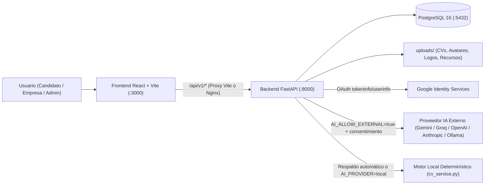

# Documentación Técnica de Arquitectura y Uso — PrepIA

> **Estado documentado:** Basado estrictamente en la inspección del código fuente de `D:\PrepIA\PrepIA` (FastAPI + SQLAlchemy 2.0 + Alembic + PostgreSQL 16 en backend; React 18 + Vite 5 + TypeScript + TailwindCSS en frontend).  
> **Última actualización:** Noviembre de 2026.

---

## 1. Arquitectura General del Sistema

**PrepIA** adopta una arquitectura cliente-servidor desacoplada en tres capas principales:

1. **Capa de Presentación (Frontend SPA):** Aplicación React 18 + TypeScript servida en desarrollo por Vite (`http://localhost:3000`) y en producción por Nginx (puerto interno `80`, expuesto en `3000` vía Docker Compose). Todas las llamadas de API usan la ruta relativa `/api/v1/...`, delegando el enrutamiento al proxy de Vite en desarrollo o a `nginx.conf` en contenedor.
2. **Capa de Aplicación y Negocio (Backend REST):** API en FastAPI (`app/main.py`) con validación Pydantic v2, autenticación JWT (`python-jose` + `bcrypt`), integración OAuth 2.0 con Google (`httpx`), procesamiento de documentos (`pypdf`, XML de `.docx`, `render_cover.ps1`), lógica ATS colombiana (DIAN NIT/DV, Ley 1581) y capa de IA multi-proveedor (`llm_provider.py` + `cv_ai_analyzer.py` + `cv_service.py`).
3. **Capa de Persistencia (PostgreSQL 16 + Almacenamiento Local de Archivos):** Base de datos relacional gestionada con SQLAlchemy 2.0 y 7 migraciones Alembic. Los archivos binarios (Hojas de Vida, portadas PNG, fotos de perfil, logos empresariales y recursos de estudio) se almacenan bajo `backend/uploads/`.

---

## 2. Organización Real del Repositorio

En la raíz `D:\PrepIA\PrepIA` existen dos *junctions* de Windows para unificar rutas de trabajo y Docker Compose:

- `backend` → `D:\PrepIA\PrepIA\prepia-backend-starter\prepia-backend`
- `frontend` → `D:\PrepIA\PrepIA\prepia-frontend`

### 2.1 Backend (`backend/`)

| Ruta | Responsabilidad |
|---|---|
| `app/main.py` | Instancia de `FastAPI`, configuración `CORSMiddleware`, endpoint `/health` e inclusión de routers `/api/v1/auth`, `/api/v1/catalogos`, `/api/v1/admin`, `/api/v1/empresa`. |
| `app/core/config.py` | Clase `Settings(BaseSettings)` que lee `.env` (BD, JWT, OAuth, IA, CORS). |
| `app/core/database.py` | Motor SQLAlchemy, `SessionLocal`, `Base` y dependencia `get_db`. |
| `app/core/security.py` | Pre-hash SHA-256 + `bcrypt`, emisión/decodificación de tokens JWT (`access` / `refresh`) con `jti`, y `hash_token()` SHA-256. |
| `app/core/deps.py` | Dependencias `get_current_user` y `require_roles(...)`. |
| `app/models/*.py` | 27 clases ORM distribuidas en 7 archivos (`usuarios`, `ejercicios`, `seleccion`, `sesiones`, `retroalimentacion`, `privacidad`, `soporte`). |
| `app/schemas/*.py` | Contratos Pydantic v2 para autenticación (`auth.py`), catálogos (`catalogos.py`) y empresa/ATS Colombia (`empresa.py`). |
| `app/routers/*.py` | Endpoints REST (`auth.py`, `candidato.py`, `catalogos.py`, `empresa.py`, `admin.py`). |
| `app/services/` | Lógica de negocio: `auth_service.py`, `cv_service.py`, `cv_ai_analyzer.py`, `llm_provider.py`, `render_cover.ps1`. |
| `alembic/versions/` | 7 scripts de migración incremental desde esquema v3 hasta soporte ATS y preguntas de entrevista. |
| `tests/` | 3 suites `pytest` (`test_ats_empresa.py`, `test_empresa_colombia.py`, `test_ia_analisis_cv.py`). |

### 2.2 Frontend (`frontend/`)

| Ruta | Responsabilidad |
|---|---|
| `src/App.tsx` | Enrutador principal con `BrowserRouter` (`react-router-dom`). |
| `src/services/api.ts` | Cliente HTTP hacia `/api/v1`, manejo de sesión en `localStorage` (`prepia_current_user`, `prepia_access_token`, `prepia_refresh_token`) y utilidades de validación de contraseña. |
| `src/services/theme.ts` | Gestión de tema claro/oscuro. |
| `src/data/colombia.ts` | Departamentos, ciudades, industrias, etapas ATS (`ATS_ETAPAS_CO`) y utilidades como enlace WhatsApp Colombia. |
| `src/app/pages/` | Páginas activas: `Root.tsx`, `Landing.tsx`, `Login.tsx`, `Register.tsx`, `CandidateDashboard.tsx`, `CompanyDashboard.tsx`, `AdminDashboard.tsx`, `Empleos.tsx`, `Showcase.tsx`. |
| `src/app/components/` | Componentes activos de negocio y UI (`GoogleAuthModal.tsx`, `ForgotPasswordModal.tsx`, `RegisterFormCard.tsx`, `JobSearchExplorer.tsx`, `StructuredResumeCard.tsx`, `CompanyProfileTab.tsx`, `CompanyApplicantsTab.tsx`, `CompanyTalentsTab.tsx`, `VacancyFormModal.tsx`, `InterviewSimulator.tsx`, `DressCodeGuide.tsx`, `ui/`). |
| `src/components/` | Componentes heredados de prototipo inicial (no montados en `App.tsx`, conservados como referencia histórica). |
| `vite.config.ts` | Servidor Vite en puerto `3000`, `preserveSymlinks: true`, alias `@` y proxy `/api` → `http://localhost:8000`. |
| `nginx.conf` | Configuración Nginx para producción: `try_files` SPA y proxy `/api/` → `http://backend:8000`. |

---

## 3. Modelo de Datos y Migraciones

### 3.1 Migraciones Alembic Implementadas

1. `33e43b79d2aa_esquema_inicial_v3.py` — Tablas base de usuarios, OAuth, recuperación, sesiones, ejercicios, pistas, casos de prueba, sesiones de prueba, retroalimentación, grabaciones, análisis de comunicación, recomendaciones, tickets de soporte, privacidad y auditoría.
2. `3d615b93b82d_datos_base_niveles_y_lenguajes.py` — Semilla inicial de `niveles_dificultad` y `lenguajes_programacion`.
3. `a4c91e7b2f10_esquema_v4_seleccion.py` — Evolución a plataforma de selección: `empresas`, `perfiles_profesionales`, `opciones_pregunta`, `hojas_de_vida`, `vacantes`, `vacante_ejercicios`, `postulaciones`, `analisis_cv`, `decisiones_postulacion`, rol `reclutador` y tipos adicionales de consentimiento.
4. `c0e5eab960b8_verificar.py` — Revisión de verificación del esquema.
5. `d7b4f1a2e801_empresa_colombia_y_vacantes_flexibles.py` — Campos colombianos en `empresas` (NIT, DV, RUT, CIIU, tamaño, ubicación, contacto, Ley 1581, logo) y vacantes flexibles multi-industria con rangos salariales en COP.
6. `e8c1a3d4f902_ats_pipeline_preguntas_y_analisis.py` — Etapas ATS, notas/calificación del reclutador, preguntas filtro, notificaciones y proveedor IA en `analisis_cv`.
7. `f9d2b4e6a103_analisis_cv_preguntas_entrevista.py` — Columnas `preguntas_entrevista` y `updated_at` en `analisis_cv`.

### 3.2 Inventario Real de Modelos SQLAlchemy (`app/models/`)

| Módulo | Clases ORM | Tablas | Estado de exposición REST actual |
|---|---|---|---|
| `usuarios.py` | `Usuario`, `IdentidadOAuth`, `TokenVerificacionEmail`, `TokenRecuperacion`, `SesionAuth` | `usuarios`, `identidades_oauth`, `tokens_verificacion_email`, `tokens_recuperacion`, `sesiones_auth` | Activo en `auth.py`, `admin.py`, `candidato.py`, `empresa.py` |
| `seleccion.py` | `Empresa`, `HojaDeVida`, `Vacante`, `VacanteEjercicio`, `Postulacion`, `AnalisisCV`, `DecisionPostulacion`, `Notificacion` | `empresas`, `hojas_de_vida`, `vacantes`, `vacante_ejercicios`, `postulaciones`, `analisis_cv`, `decisiones_postulacion`, `notificaciones` | Activo en `empresa.py`, `candidato.py`, `admin.py` (`VacanteEjercicio` preparado para pruebas por vacante) |
| `ejercicios.py` | `NivelDificultad`, `Tema`, `LenguajeProgramacion`, `PerfilProfesional`, `Ejercicio`, `Pista`, `CasoPrueba`, `OpcionPregunta`, `RecursoPreparacion` | `niveles_dificultad`, `temas`, `lenguajes_programacion`, `perfiles_profesionales`, `ejercicios`, `pistas`, `casos_prueba`, `opciones_pregunta`, `recursos_preparacion` | `NivelDificultad`, `LenguajeProgramacion`, `Tema` en `catalogos.py`; `PerfilProfesional` y `RecursoPreparacion` en `admin.py` / `candidato.py`; banco de `Ejercicio` preparado para módulo futuro |
| `privacidad.py` | `HistorialConsentimiento`, `SolicitudPrivacidad`, `LogAuditoria` | `historial_consentimientos`, `solicitudes_privacidad`, `logs_auditoria` | `HistorialConsentimiento` activo en `candidato.py` y `cv_ai_analyzer.py`; `SolicitudPrivacidad` y `LogAuditoria` definidos en BD |
| `sesiones.py` | `SesionPrueba`, `RespuestaSesion`, `ResultadoEjecucion` | `sesiones_prueba`, `respuestas_sesion`, `resultados_ejecucion` | Consultado en métricas/chat del candidato; endpoints de ejecución de pruebas pendientes de router dedicado |
| `retroalimentacion.py` | `RetroalimentacionIA`, `GrabacionSesion`, `AnalisisComunicacion`, `Recomendacion` | `retroalimentaciones_ia`, `grabaciones_sesion`, `analisis_comunicacion`, `recomendaciones` | Modelos ORM preparados para fases futuras (audio/video y recomendaciones) |
| `soporte.py` | `TicketSoporte`, `MensajeTicket` | `tickets_soporte`, `mensajes_ticket` | Modelos ORM preparados para módulo de soporte |

---

## 4. Catálogo Real de Endpoints REST

### 4.1 Salud y Autenticación (`/health`, `/api/v1/auth`)

| Método | Ruta | Descripción | Seguridad |
|---|---|---|---|
| `GET` | `/health` | Estado del servicio (`{"status": "ok"}`) | Pública |
| `GET` | `/api/v1/auth/ping` | Verifica conectividad con PostgreSQL | Pública |
| `POST` | `/api/v1/auth/register` | Registro de cuenta (asigna siempre `rol="usuario"`) | Pública |
| `POST` | `/api/v1/auth/login` | Login con email y contraseña; emite access + refresh JWT | Pública |
| `POST` | `/api/v1/auth/refresh` | Rotación de refresh token (revoca el anterior en `sesiones_auth`) | Pública (refresh token) |
| `POST` | `/api/v1/auth/logout` | Revoca la sesión asociada al refresh token (`204`) | Pública (refresh token) |
| `GET` | `/api/v1/auth/me` | Retorna el usuario autenticado | Bearer JWT |
| `POST` | `/api/v1/auth/forgot-password` | Genera código de 6 dígitos (expira en 15 min; incluye `codigo_dev`) | Pública |
| `POST` | `/api/v1/auth/reset-password` | Valida código y actualiza `password_hash` | Pública |
| `GET` | `/api/v1/auth/google/config` | Expone `{configured, client_id}` según `GOOGLE_CLIENT_ID` | Pública |
| `POST` | `/api/v1/auth/google` | Valida `credential` (ID token) o `access_token` con Google y emite JWT | Pública |

### 4.2 Candidato, CV, Vacantes y Privacidad (`/api/v1/auth` y `/api/v1/auth/candidato`)

> `auth.py` monta `candidato.router` bajo ambos prefijos (`/api/v1/auth/candidato/...` y `/api/v1/auth/...`). El frontend `src/services/api.ts` consume las rutas bajo `/api/v1/auth/...`.

| Método | Ruta | Funcionalidad |
|---|---|---|
| `GET` | `/metricas` | Métricas reales en PostgreSQL: completitud, CV, postulaciones, sesiones, foto y `perfil_cv` |
| `POST` | `/cv/analizar-archivo` | Sube PDF/DOCX/TXT, extrae texto, analiza, guarda en `hojas_de_vida` y genera portada PNG |
| `POST` | `/cv/analizar-texto` | Analiza CV en texto plano |
| `GET` | `/cv/portada` | Retorna imagen PNG de la primera página del CV (`render_cover.ps1`) |
| `GET` | `/cv/archivo` | Sirve o descarga el archivo original del CV |
| `DELETE` | `/cv/eliminar` | Elimina CV(s) en disco y en `hojas_de_vida` |
| `PUT` | `/hoja-estructurada` | Guarda `perfil_cv_json` (experiencias, estudios, idiomas, habilidades, movilidad) |
| `POST` / `GET` / `DELETE` | `/perfil/foto` | Sube, consulta o elimina foto de perfil del candidato |
| `PUT` | `/perfil` | Actualiza datos personales, especialidad, ciudad, LinkedIn, GitHub y biografía |
| `POST` | `/cv/chat` | Asistente IA contextual conectado a CV, vacantes abiertas, postulaciones y sesiones |
| `GET` | `/vacantes` | Lista vacantes `estado="abierta"` con filtros (`q`, `ciudad`, `modalidad`, `experiencia`, `tipo_contrato`, `salario_rango`, `salario_min`, `salario_max`, `categoria`, `fecha`, `orden`) |
| `POST` | `/vacantes/evaluar` | Compara el CV del candidato contra requisitos de una vacante específica |
| `POST` | `/vacantes/postular` | Valida CV y preguntas filtro obligatorias, crea `Postulacion` y ejecuta `analizar_postulacion_con_ia` |
| `POST` | `/postulaciones/{postulacion_id}/analizar` | Re-analiza una postulación y hace upsert en `analisis_cv` |
| `GET` / `POST` | `/privacidad/consentimiento-ia` | Consulta o registra consentimiento `tipo="terceros"` en `historial_consentimientos` (append-only) |
| `GET` | `/postulaciones` | Historial de postulaciones y etapa ATS del candidato |
| `GET` | `/recursos` y `/recursos/{recurso_id}/archivo` | Lista y descarga recursos reales publicados por administración |
| `GET` / `PATCH` | `/notificaciones` y `/notificaciones/{notif_id}/leer` | Notificaciones de empresas (interés, invitación a entrevista, cambio de etapa) |

### 4.3 Catálogos (`/api/v1/catalogos`)

| Método | Ruta | Seguridad |
|---|---|---|
| `GET` | `/niveles`, `/lenguajes`, `/temas` | `get_current_user` |
| `POST` | `/temas` | `require_roles("admin")` |

### 4.4 Empresa y ATS (`/api/v1/empresa`) — Roles `reclutador`, `admin`

| Método | Ruta | Funcionalidad |
|---|---|---|
| `GET` | `/overview` | Datos de empresa, estadísticas, vacantes, postulantes rankeados y directorio de talento |
| `GET` / `PUT` | `/perfil` | Consulta o actualiza perfil empresarial colombiano (NIT/RUT, CIIU, ubicación, contacto, Ley 1581) |
| `POST` | `/nit/calcular-dv` | Calcula dígito de verificación oficial DIAN |
| `POST` / `GET` | `/perfil/logo` y `/perfil/logo/{empresa_id}` | Sube o sirve logo corporativo |
| `POST` / `PUT` / `PATCH` / `DELETE` | `/vacantes`, `/vacantes/{id}`, `/vacantes/{id}/estado`, `/vacantes/{id}` | Crear (entra en `pendiente_aprobacion`), editar, pausar/reactivar/cerrar vacantes aprobadas, eliminar |
| `PATCH` | `/postulaciones/{postulacion_id}` | Actualiza etapa ATS, notas privadas, estrellas (1–5), registra `DecisionPostulacion` y notifica al candidato |
| `GET` | `/postulaciones/{postulacion_id}/cv` y `/candidatos/{usuario_id}/cv` | Visualiza/descarga CV del postulante o talento |
| `POST` | `/notificar-interes` | Envía notificación de interés o invitación a entrevista |
| `POST` | `/postulaciones/{postulacion_id}/analizar-ia` | Analiza/re-analiza un postulante con Gemini o respaldo local |
| `POST` | `/vacantes/{vacante_id}/analizar-pendientes-ia` | Analiza en lote postulantes pendientes o analizados previamente en local |
| `POST` | `/talento/evaluar-match` | Evalúa afinidad de un candidato del directorio contra una vacante |
| `POST` | `/vacantes/{vacante_id}/comparar-ia` | Compara de 2 a 5 postulantes de una vacante con Gemini o respaldo local |

### 4.5 Administración (`/api/v1/admin`) — Rol `admin`

| Método | Ruta | Funcionalidad |
|---|---|---|
| `GET` | `/overview` | Estadísticas reales, usuarios, empresas, categorías, vacantes, recursos y analíticas |
| `PATCH` | `/users/{user_id}/role` | Cambia rol; protege al `es_admin_principal` y restringe promoción/remoción de `admin` solo al Administrador Principal; vincula o crea empresa si `rol="reclutador"` |
| `PATCH` | `/users/{user_id}/status` | Suspende (`deleted_at` + revoca `sesiones_auth`) o reactiva cuentas |
| `DELETE` | `/users/{user_id}` | Elimina cuenta si no posee vacantes ni decisiones históricas (`409` en caso contrario) |
| `POST` / `DELETE` | `/categories`, `/categories/{category_id}` | Gestión de `perfiles_profesionales` |
| `PATCH` | `/vacantes/{vacante_id}/approval` | Aprueba (`abierta`), rechaza (`rechazada` + motivo), cierra o devuelve a `pendiente_aprobacion` |
| `POST` / `DELETE` | `/recursos`, `/recursos/{recurso_id}` | Publica o elimina material real (archivo en disco o URL externa) |

---

## 5. Flujos Críticos de Seguridad, Privacidad e IA

### 5.1 Autenticación y Google OAuth en `http://localhost:3000`
1. En el frontend, `GoogleAuthModal.tsx` consulta `GET /api/v1/auth/google/config`. Si `configured=false`, informa que falta `GOOGLE_CLIENT_ID`.
2. Cuando está configurado, inicializa Google Identity Services (`window.google.accounts.id`) en el origen `http://localhost:3000` (el cual debe estar autorizado en Google Cloud Console dentro de *Authorized JavaScript origins*).
3. El token (`credential` o `access_token`) se envía a `POST /api/v1/auth/google`. El backend verifica `aud` contra `settings.GOOGLE_CLIENT_ID`, `iss`, `email_verified`, crea/vincula `Usuario` + `IdentidadOAuth` y emite tokens propios JWT de PrepIA.
4. Todo registro público (`POST /register` o primer acceso Google) crea la cuenta con `rol="usuario"`. Las cuentas `reclutador` o `admin` solo se promueven mediante `PATCH /api/v1/admin/users/{id}/role`.

### 5.2 Consentimiento de Privacidad y Anonimización antes de IA Externa
El módulo `cv_ai_analyzer.py` implementa defensa en profundidad antes de invocar proveedores externos:
1. **Compuerta de configuración:** Si `AI_PROVIDER == "local"` o `AI_ALLOW_EXTERNAL == False`, nunca realiza peticiones HTTP externas y usa `_local_fallback_analysis()`.
2. **Compuerta de consentimiento por usuario (`historial_consentimientos`):**
   - Para el **candidato** (`puede_enviar_a_ia_externa`): exige que el último registro con `tipo="terceros"` tenga `aceptado=True`.
   - Para la **empresa** (`puede_empresa_enviar_a_ia_externa`): si el candidato revocó explícitamente `'terceros'` (`aceptado=False`), bloquea el envío externo; en caso contrario permite si aceptó `'terceros'`, `'compartir_empresa'` o realizó una postulación voluntaria.
3. **Anonimización (`anonimizar_texto`):** Elimina líneas con atributos protegidos (edad, estado civil, género, sexo, nacionalidad, fecha/lugar de nacimiento, foto) y reemplaza correos (`[CORREO]`), enlaces (`[ENLACE]`), usuarios `@` (`[USUARIO]`), documentos CC/NIT/pasaporte (`[DOCUMENTO]`), teléfonos (`[TELEFONO]`), fechas de nacimiento (`[FECHA_NACIMIENTO]`), direcciones (`[DIRECCION]`) y el nombre del candidato (`[CANDIDATO]`), truncando a `12.000` caracteres.
4. **Mitigación de *Prompt Injection*:** El prompt del sistema marca `<hoja_de_vida>` como `DATO NO CONFIABLE` e instruye registrar cualquier intento de manipulación en `alertas`.

### 5.3 Motor Gemini y Respaldo Local Automático
En `llm_provider.py`, `_call_gemini()` construye dinámicamente una lista ordenada y sin duplicados de modelos candidatos:
`[settings.GEMINI_MODEL, "gemini-3-flash-preview", "gemini-3.1-flash-lite-preview", "gemini-flash-latest"]`.
- Ante `HTTP_404` (modelo retirado/no disponible), `HTTP_429` (límite de tasa) o `HTTP_503` (indisponibilidad temporal), reintenta el siguiente modelo de la lista.
- La respuesta JSON del LLM pasa por `_extract_json_object()` y validación estricta `AnalisisCVOutput` (rangos `0..100` para afinidad, `0..80` años de experiencia, máximo `600` caracteres en resumen). Si falla dos veces o ocurre `LLMProviderError`, conmuta sin error hacia `_local_fallback_analysis()` (`cv_service.evaluate_cv_for_vacancy()`), garantizando continuidad del servicio.

---

## 6. Despliegue y Rutas en Frontend (`src/App.tsx`)

| Ruta SPA | Página | Propósito |
|---|---|---|
| `/` | `Landing` | Página de bienvenida y propuesta de valor |
| `/login` | `Login` | Acceso por correo/contraseña, Google OAuth y recuperación de clave |
| `/register` | `Register` | Registro de nuevos candidatos (correo o Google) |
| `/dashboard` | Redirección | Redirige a `/dashboard/candidate` |
| `/dashboard/candidate` | `CandidateDashboard` | Resumen, análisis de CV, chat IA, empleos, simulador de entrevistas, vestimenta, notificaciones, recursos y consentimiento IA |
| `/dashboard/company` | `CompanyDashboard` | Perfil DIAN/Ley 1581, vacantes, postulantes ATS, comparador IA y directorio de talento |
| `/dashboard/admin` | `AdminDashboard` | Métricas globales, roles/permisos, empresas, categorías, aprobación de vacantes y recursos |
| `/empleos` | `Empleos` | Explorador público de vacantes abiertas |
| `/showcase` | `Showcase` | Vista demostrativa de componentes |
| `/resources` | Redirección | Redirige a `/dashboard/candidate` |
